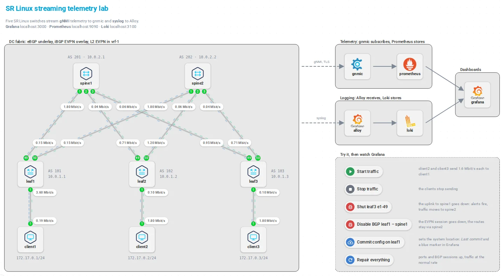
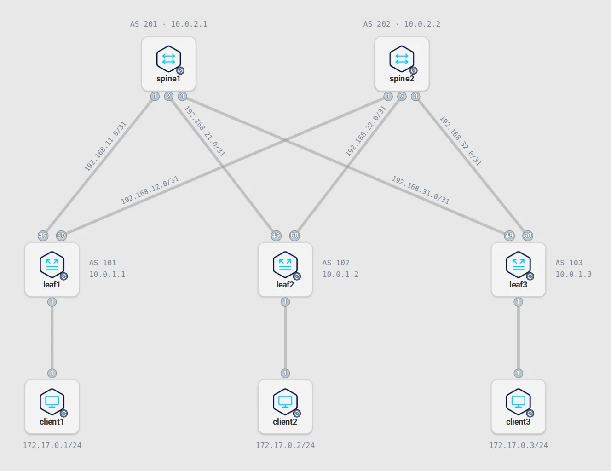
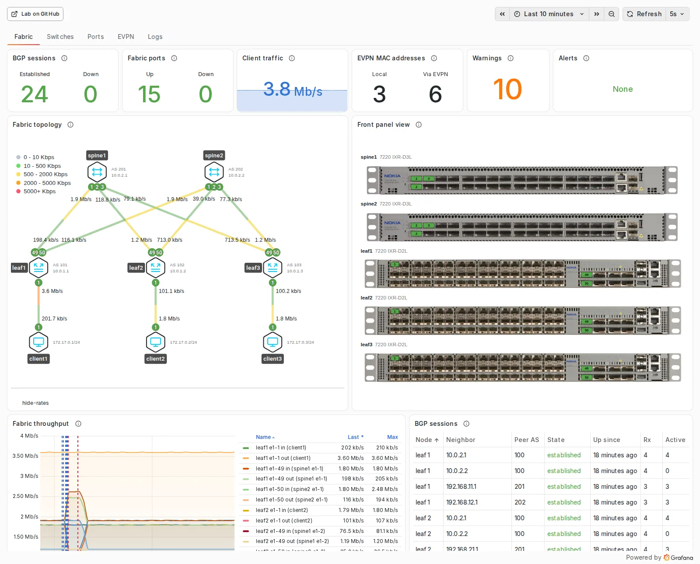

# Nokia SR Linux Streaming Telemetry Lab

[![Discord][discord-svg]][discord-url] [![DevPod][devpod-svg]][devpod-url] [![Codespaces][codespaces-svg]][codespaces-url]  
![w212][w212][Learn more](https://containerlab.dev/macos/#devpod) ![w90][w90][Learn more](https://containerlab.dev/manual/codespaces)

[discord-svg]: https://gitlab.com/rdodin/pics/-/wikis/uploads/b822984bc95d77ba92d50109c66c7afe/join-discord-btn.svg
[discord-url]: https://discord.gg/tZvgjQ6PZf
[devpod-svg]: https://gitlab.com/rdodin/pics/-/wikis/uploads/dfc36636ecaa60f3e70340686d5800db/open-in-devpod-btn.svg
[devpod-url]: https://devpod.sh/open#https://github.com/srl-labs/srl-telemetry-lab
[codespaces-svg]: https://gitlab.com/rdodin/pics/-/wikis/uploads/80546a8c7cda8bb14aa799d26f55bd83/run-codespaces-btn.svg
[codespaces-url]: https://codespaces.new/srl-labs/srl-telemetry-lab?quickstart=1&devcontainer_path=.devcontainer%2Fdocker-in-docker%2Fdevcontainer.json
[w212]: https://gitlab.com/rdodin/pics/-/wikis/uploads/718a32dfa2b375cb07bcac50ae32964a/w212h1.svg
[w90]: https://gitlab.com/rdodin/pics/-/wikis/uploads/bf1b8ea28b4528eb1b66567355a13c5c/w90h1.svg

SR Linux has first-class streaming telemetry support thanks to [100% YANG coverage](https://learn.srlinux.dev/yang/) of state and config data. You can stream **any** data off the switch with on-change, sample or target-defined subscriptions, and every API sees the same data: what the CLI shows can also be streamed over gNMI.

This lab is a small Clos fabric of [Nokia SR Linux](https://learn.srlinux.dev/) switches running as containers, with a telemetry stack of [gnmic](https://gnmic.openconfig.net), [Prometheus](https://prometheus.io) and [Grafana](https://grafana.com), and a logging stack of [Grafana Alloy](https://grafana.com/docs/alloy/latest/) and [Loki](https://grafana.com/oss/loki/).

<picture>
  <source media="(prefers-color-scheme: dark)" srcset="images/topology-view-dark.webp">
  
</picture>

Open [st.clab.yml](st.clab.yml) in the [containerlab app](https://containerlab.app) to see the lab like this. The buttons start traffic and run the [scenarios](#scenarios) described below.

Goals of this lab:

1. Show how a telemetry and logging stack becomes part of the containerlab topology file.
2. Explain the SR Linux telemetry support, with sample and on-change gNMI subscriptions.
3. Give practical gnmic configuration examples: subscriptions, processors and the export to Prometheus.
4. Build advanced Grafana dashboards: a live topology map and faceplates with the [flow panel](https://grafana.com/grafana/plugins/andrewbmchugh-flow-panel/) plugin, the EVPN overlay, alerts and logs.
5. Collect the SR Linux syslog with Grafana Alloy and Loki, and tell events from debug traces.
6. Break the fabric on purpose and watch it in the telemetry.

## Deploying the lab

The lab is deployed with [containerlab](https://containerlab.dev); [`st.clab.yml`](st.clab.yml) describes its topology. In the cloned directory:

```bash
containerlab deploy --reconfigure
```

To remove the lab:

```bash
containerlab destroy --cleanup
```

## Accessing the lab

The SR Linux switches are reachable over SSH by their name, the Linux clients with `docker exec`:

```bash
ssh admin@leaf1
ssh admin@spine1
docker exec -it client1 bash
```

The telemetry and logging services are exposed on the host:

| Service    | Address                  | Notes                                                        |
| ---------- | ------------------------ | ------------------------------------------------------------ |
| Grafana    | <http://localhost:3000>  | Anonymous access, no login needed; `admin/admin` to sign in |
| Prometheus | <http://localhost:9090>  | Queries, rules and alerts                                    |
| Loki       | <http://localhost:3100>  | API only, query the logs in Grafana                          |
| Alloy      | <http://localhost:12345> | State of the log pipeline                                    |

## Fabric configuration

The fabric has two spines and three leaves, with a client behind each leaf. The diagram shows the subnet of each link, the AS number and system address of each switch and the address of each client.

<picture>
  <source media="(prefers-color-scheme: dark)" srcset="images/fabric-dark.webp">
  
</picture>

Leaves and spines are 7220 IXR-D2L and IXR-D3L switches. Each switch gets its [startup configuration](configs/fabric/) at boot.

Once booted, the switches come up with their interfaces, underlay protocols and overlay service configured. The fabric runs a Layer 2 EVPN service between the leaves.

### Verifying the underlay and overlay status

The underlay runs eBGP, the overlay iBGP with EVPN. The Layer 2 EVPN service is configured as explained in the [L2 EVPN tutorial](https://learn.srlinux.dev/tutorials/l2evpn/intro/).

On a leaf, `show network-instance default protocols bgp neighbor` lists the BGP sessions:

```
BGP neighbor summary for network-instance "default"
Peer flags: see legend after the summary when applicable.
+----------------------+--------------------------------+----------------------+--------+------------+------------------+------------------+----------------------------------------------+
|       Net-Inst       |              Peer              |        Group         | Flags  |  Peer-AS   |      State       |      Uptime      |           AFI/SAFI [Rx/Active/Tx]            |
+======================+================================+======================+========+============+==================+==================+==============================================+
| default              | 10.0.2.1                       | iBGP-overlay         | S      | 100        | established      | 0d:1h:32m:24s    | evpn [4/4/2]                                 |
| default              | 10.0.2.2                       | iBGP-overlay         | S      | 100        | established      | 0d:1h:32m:27s    | evpn [4/0/2]                                 |
| default              | 192.168.11.1                   | eBGP                 | S      | 201        | established      | 0d:1h:32m:29s    | ipv4-unicast [3/3/2]                         |
| default              | 192.168.12.1                   | eBGP                 | S      | 202        | established      | 0d:1h:32m:32s    | ipv4-unicast [3/3/4]                         |
+----------------------+--------------------------------+----------------------+--------+------------+------------------+------------------+----------------------------------------------+
Summary:
4 configured neighbors, 4 configured sessions are established, 0 disabled peers
0 dynamic peers
```

## Telemetry stack

Telemetry is at the core of the lab:

| Role                | Software                              |
| ------------------- | ------------------------------------- |
| Telemetry collector | [gnmic](https://gnmic.openconfig.net) |
| Time-series DB      | [Prometheus](https://prometheus.io)   |
| Visualization       | [Grafana](https://grafana.com)        |

### gnmic

[gnmic](https://gnmic.openconfig.net) is an OpenConfig project that subscribes to streaming telemetry of network devices and exports it to a variety of destinations. Here it subscribes to the five switches and exposes the data to Prometheus. Its configuration, [configs/gnmic/gnmic-config.yml](configs/gnmic/gnmic-config.yml), shows a few practices worth copying:

* **Sample and on-change subscriptions.** Counters and rates are sampled every 5 seconds. States (port oper-state, BGP session state, network instance state, software version) are streamed on-change, with a 10 second heartbeat that keeps the metric alive in Prometheus. Together with Prometheus scraping gnmic every second and the dashboard refreshing every second, a port or BGP session going down shows in Grafana about two seconds after it happened.
* **Verified TLS.** gnmic checks the certificates of the switches against the CA that containerlab creates for the lab, instead of skipping the verification.
* **Processors.** Prometheus only stores numbers, so a Starlark processor turns timestamps into epoch seconds, `true`/`false` into 1/0, the BGP session state into a number (6 is established) and text such as the software version and the port descriptions into labels.
* **EVPN overlay.** Besides interface, BGP, routing, bridge table and platform statistics, gnmic collects the MAC table of the MAC-VRFs (whether a MAC was learnt on a local port or received over EVPN, and where it points to), the traffic per remote VTEP and the EVPN routes of type 2 and 3.

### Prometheus

[Prometheus](https://prometheus.io) stores the telemetry exported by gnmic. [configs/prometheus/prometheus.yml](configs/prometheus/prometheus.yml) makes it scrape gnmic and evaluate the rules every second.

[configs/prometheus/rules.yml](configs/prometheus/rules.yml) holds the rules:

* Recording rules for what the dashboard and the alerts share: `srl:interface:in_use` marks the cabled ports and carries their description, `srl:switch:problems` counts the BGP sessions and cabled ports that are down per switch.
* Alert rules: `BGPSessionDown`, `PortDown`, `PortErrors` and `HighCPU`. They show in the Prometheus UI under **Alerts**, in Grafana under **Alerting > Alert rules** and on the dashboard. There is no Alertmanager, so nobody is notified.

### Grafana

[Grafana](https://grafana.com) visualizes the telemetry and the logs. The topology file provisions its datasources, the dashboard and the plugins it needs.

<picture>
  <source media="(prefers-color-scheme: dark)" srcset="images/dashboard-fabric-dark.webp">
  
</picture>

The dashboard provided by this repository is organized in tabs:

| Tab      | Shows                                                                                                                                                          |
| -------- | -------------------------------------------------------------------------------------------------------------------------------------------------------------- |
| Fabric   | Key figures of the fabric (BGP sessions, ports, client traffic, EVPN MAC addresses, warnings, alerts), a live topology map, the switch faceplates, fabric throughput and every BGP session |
| Switches | One row per selected switch with throughput, BGP, routes and MACs, network instances, ports, release, uptime, last commit, CPU and memory                       |
| Ports    | Traffic, packet, error and discard rates of the selected ports and a table of all cabled ports with what they connect to                                        |
| EVPN     | The MAC table of the leaves, the EVPN routes per switch and the VXLAN traffic per remote VTEP                                                                    |
| Logs     | Log volume per severity and the syslog messages of the selected switches and applications                                                                      |

Switches, ports and applications are picked with the [Business Variable](https://grafana.com/grafana/plugins/volkovlabs-variable-panel/) panel. A red mark next to a switch tells that one of its BGP sessions or cabled ports is down, an orange or red mark next to an application that it logged warnings or errors. The time series show markers where something happened in the fabric, taken from the logs: orange for a port going up or down, red for a BGP session changing state, blue for a configuration commit.

The topology map and the front panel view are powered by the [flow plugin](https://grafana.com/grafana/plugins/andrewbmchugh-flow-panel/), which overlays telemetry data over SVG graphics. Each half of a link is colored by the traffic rate leaving that end and labelled with it, and the port bubbles and faceplate ports are colored by their oper-state. The topology panel is generated from the topology file with the Grafana bundle export of the [containerlab app](https://containerlab.app). The SVG graphics and panel configurations of both views are in [configs/grafana/flow_panels](configs/grafana/flow_panels).

The dashboard is generated by [tools/dashboard](tools/dashboard); see its README to change and rebuild it.

## Logging stack

The switches send their syslog to Alloy, which labels the messages and ships them to Loki. They send every message above informational level. SR Linux writes two kinds of messages, and [Alloy](configs/alloy/alloy-config.alloy) tells them apart:

* **Events** report what happened: a port went down, a BGP session changed state, a commit succeeded. They get the labels `kind="event"` and `event` with the name of the event, such as `portDown` or `bgpNeighborEstablished`.
* **Traces** are the debug output of the SR Linux applications and get `kind="trace"`. At boot they come in bursts of thousands, many of them at warning level.

The message prefix (subsystem, module, source location) moves to structured metadata, so the log line is the message itself. The Logs tab shows events by default and can include the traces; the warning figure and the markers on the graphs count events only.

## Traffic generation

A freshly deployed lab carries no traffic. `traffic.sh` starts and stops iperf3 traffic from the clients to client1:

| Command                         | What it does                                                 |
| ------------------------------- | ------------------------------------------------------------ |
| `bash traffic.sh start all`     | client2 and client3 send 1.6 Mbit/s each to client1          |
| `bash traffic.sh start 1-2`     | only client2 sends                                           |
| `bash traffic.sh start 1-3`     | only client3 sends                                           |
| `bash traffic.sh start 1-2 1M`  | 8 streams of 1 Mbit/s instead of the default 200 Kbit/s      |
| `bash traffic.sh stop all`      | stops all traffic                                            |
| `bash traffic.sh status`        | shows which clients send traffic                             |

The rates show on the topology map and the throughput panels of the dashboard.

## Scenarios

`scenario.sh` breaks and repairs the fabric, so you can see it in the telemetry. Start the traffic first, open the dashboard, then try:

| Command | What happens | Where to look |
| --- | --- | --- |
| `bash scenario.sh port-down leaf3 e1-49` | The uplink from leaf3 to spine1 goes down | The port turns red on the topology and the faceplate, the `PortDown` and `BGPSessionDown` alerts fire, the traffic moves to spine2 |
| `bash scenario.sh bgp-down leaf1 10.0.2.1` | The EVPN session from leaf1 to spine1 is disabled | The BGP sessions table, a red marker on the graphs; the EVPN tab shows that the MAC addresses stay, learnt over spine2 |
| `bash scenario.sh congest` | client2 sends 8 Mbit/s to client1 | The access links of leaf1 and leaf2 turn red on the topology |
| `bash scenario.sh commit leaf1` | Changes the configuration of leaf1 and commits it; the change is harmless, it sets the system location | **Last commit** on the Switches tab, a blue marker on the graphs |
| `bash scenario.sh status` | Lists ports and BGP sessions that are not up | |
| `bash scenario.sh reset` | Undoes all of the above | Everything turns green again |

## Smoke test

[tools/smoke-test.mjs](tools/smoke-test.mjs) checks a deployed lab: BGP, telemetry, EVPN data, logs, alerts and every tab of the dashboard. The [smoke test workflow](.github/workflows/smoke-test.yml) runs it on GitHub for every pull request.

```bash
npm ci --prefix tools
npx --prefix tools playwright install chromium
START_TRAFFIC=1 node tools/smoke-test.mjs
```
